# Joiner–Mover–Leaver (JML) Identity Lifecycle Lab — Microsoft Entra ID

 

## Overview

In this lab I simulated the full identity lifecycle of employees in Microsoft Entra ID: onboarding a new hire, processing an internal promotion, and offboarding a departing employee. This process is known as **Joiner–Mover–Leaver (JML)**, and it's one of the core responsibilities of Identity and Access Management (IAM).

I built a small fictional organization, **Northbridge University IT**, and walked three users through each stage, verifying every change and documenting it with screenshots and audit-log evidence.

| Stage | Scenario |
|---|---|
| **Joiner** | Maya Carter is hired as a Finance Analyst |
| **Mover** | Jordan Lee is promoted from Help Desk Analyst to Security Analyst |
| **Leaver** | Chris Patel, a Finance Analyst, resigns |

### Skills demonstrated
- User provisioning and attribute management (job title, department, manager, employee ID)
- Security group design and group-based access control
- Least privilege and preventing privilege creep
- Microsoft Entra admin role assignment and removal
- Secure offboarding: blocking sign-in, revoking sessions, removing access, soft-delete
- Auditing and evidence collection with Entra ID audit and sign-in logs
- Troubleshooting an unexpected platform behavior during offboarding

---

## Table of Contents
1. [Building the Environment](#1-building-the-environment)
2. [Joiner — Maya Carter](#2-joiner--maya-carter)
3. [Mover — Jordan Lee](#3-mover--jordan-lee)
4. [Leaver — Chris Patel](#4-leaver--chris-patel)
5. [Audit and Evidence](#5-audit-and-evidence)
6. [Key Findings](#6-key-findings)
7. [How This Works in the Real World](#7-how-this-works-in-the-real-world)

---

## 1. Building the Environment

Before running any lifecycle events, I needed an organization to work in: departments with defined access, and existing employees.

### Security groups
Rather than assigning access to people one at a time, I used **group-based access control**: access is granted to a group, and people are added to or removed from that group as their role changes. This keeps JML manageable and auditable.

I created four security groups using a consistent naming convention (`SG-` for security group, `Dept-` for department-based):

| Group | Purpose |
|---|---|
| `SG-AllStaff` | All active employees |
| `SG-Dept-Finance` | Finance systems and shares |
| `SG-Dept-IT-HelpDesk` | Ticketing and support tools |
| `SG-Dept-Security` | Security tooling and logs |

All groups use **Assigned** membership, meaning an admin controls who is in them.

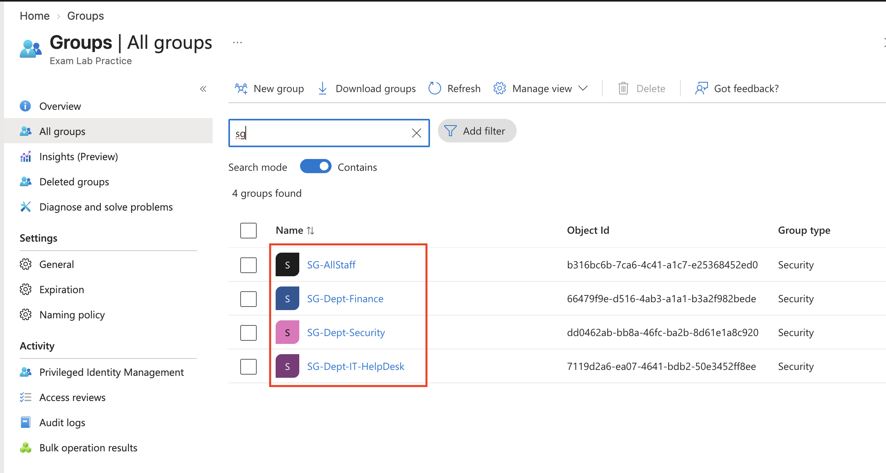

### Existing employees
I created four existing employees, each with a job title, department, employee ID, and manager. Managers matter because in real organizations they approve access requests and are involved in offboarding.

| Name | Job title | Department | Manager |
|---|---|---|---|
| Dana Brooks | Finance Manager | Finance | — |
| Sam Rivera | Director of IT | IT | — |
| Jordan Lee | Help Desk Analyst | IT Help Desk | Sam Rivera |
| Chris Patel | Finance Analyst | Finance | Dana Brooks |

I added everyone to `SG-AllStaff` and to their department's group.

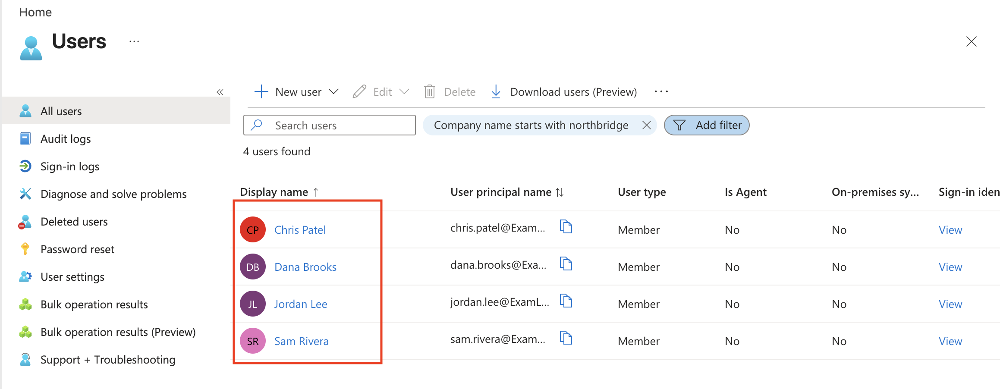

### Admin role
Help desk staff need to reset users' passwords, so I assigned Jordan the **Helpdesk Administrator** role. Group membership controls access to *resources*, while Entra admin roles control what someone can do *to the directory itself*. Because admin roles are high-risk, they need to be removed as soon as someone no longer needs them, which became important in the Mover stage.

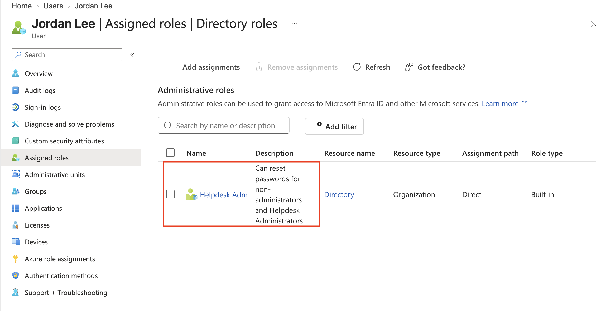

---

## 2. Joiner — Maya Carter

**Scenario:** HR notified IT that Maya Carter was hired as a Finance Analyst reporting to Dana Brooks.

### Account creation
I created Maya's account with her job title, department, employee ID, and manager, and used an **auto-generated temporary password**. IT should never know a user's real password; the temporary password is handed off securely, and Entra forces the user to set their own at first sign-in.

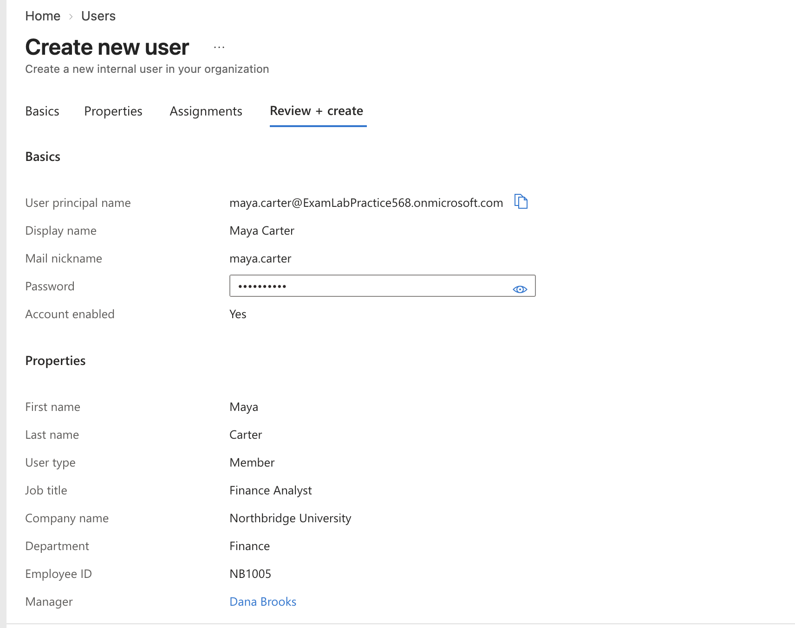

### Least-privilege access
I added Maya to only `SG-AllStaff` and `SG-Dept-Finance`. She received no Help Desk or Security access and no admin roles. This is **least privilege**: giving people only the access their role requires.

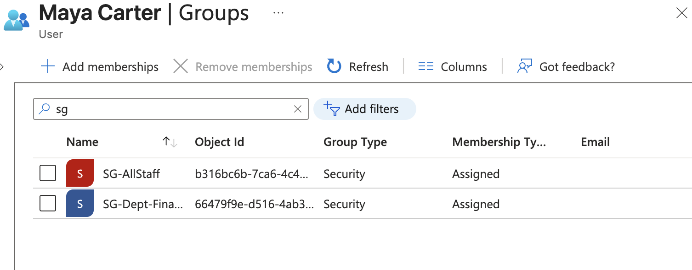

### Day-one verification
I signed in as Maya in a private browser window to confirm the account worked, completed the forced password change, and confirmed she could reach her account page. A joiner process isn't complete until the new hire can actually work on day one.

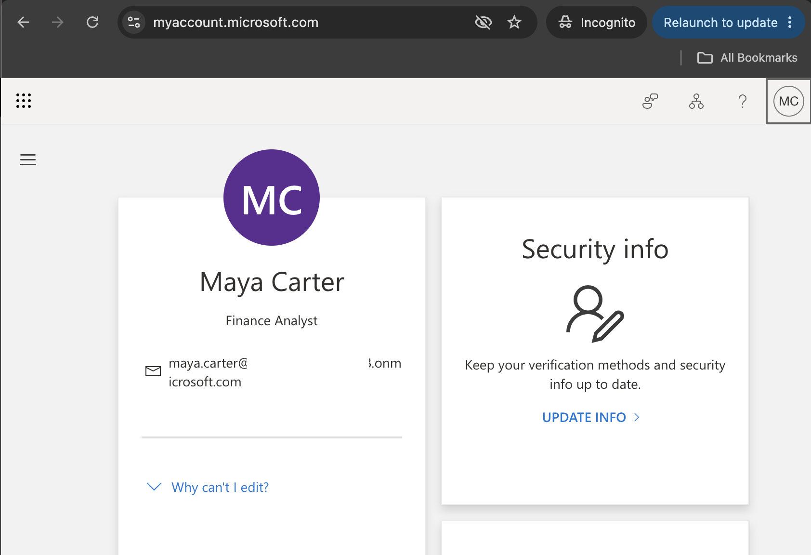

---

## 3. Mover — Jordan Lee

**Scenario:** Jordan Lee was promoted from Help Desk Analyst to Security Analyst.

### Avoiding privilege creep
The most common mistake in a mover process is only *adding* access for the new role. Over time, someone who moves through several teams accumulates access from all of them. This is called **privilege creep**, and it means a compromised account exposes everything the person ever had. A correct mover process both adds new access and removes old access.

### Before
I documented Jordan's access before making any changes, to create an audit trail.

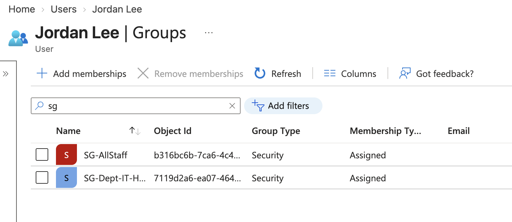

### Changes made
1. **Updated attributes:** changed Job title to *Security Analyst* and Department to *Security*. These attributes are the source of truth for directories, org charts, and automated access rules.
2. **Added new access:** added Jordan to `SG-Dept-Security` and assigned the **Security Reader** role.
3. **Removed old access:** removed Jordan from `SG-Dept-IT-HelpDesk` and removed the **Helpdesk Administrator** role.

I chose **Security Reader** rather than Security Administrator because the role needs to *view* security reports and alerts, not change security policy.

### After

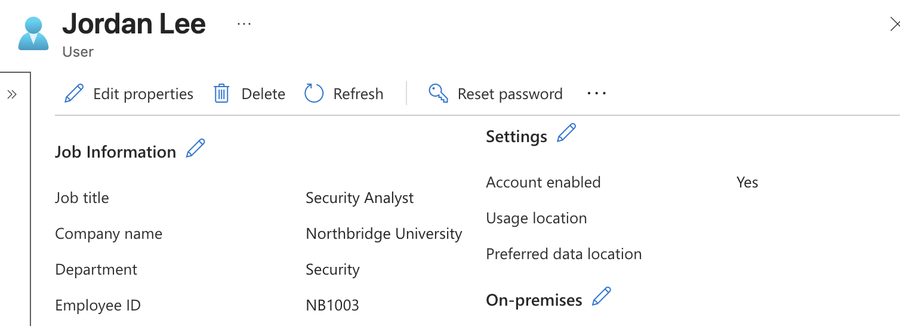

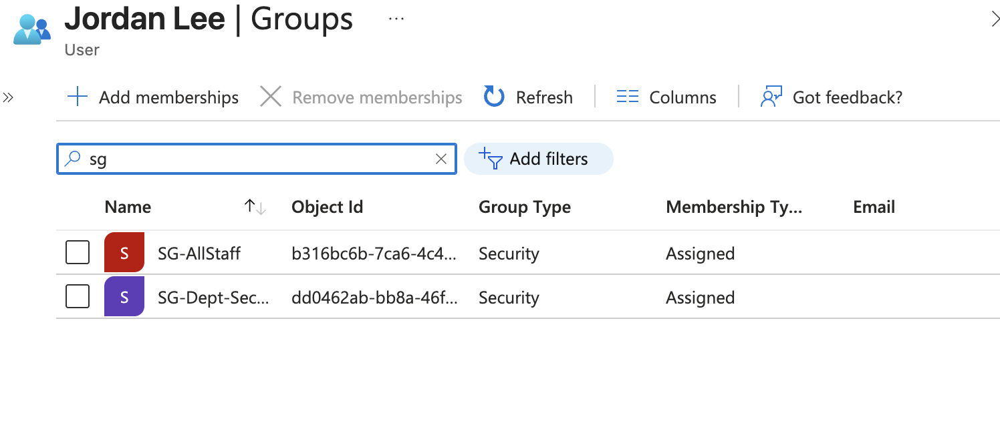

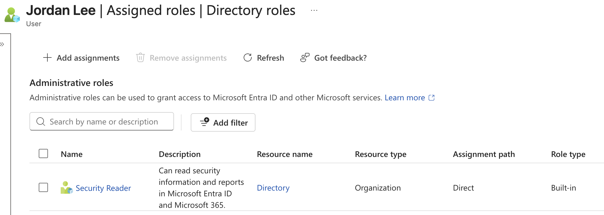

Jordan kept `SG-AllStaff` and the new Security access, and lost both the Help Desk group and the Helpdesk Administrator role.

---

## 4. Leaver — Chris Patel

**Scenario:** Chris Patel resigned, and HR asked IT to remove access on the last day.

To test the process realistically, I first signed in as Chris in a private browser window and left the session open, simulating an employee who is still logged in at their desk.

### Lockout
1. **Blocked sign-in** by disabling the account, which stops any new sign-ins.
2. **Revoked sessions.** Blocking sign-in doesn't remove someone who is already signed in, because their apps hold tokens that stay valid for a while. Revoking sessions invalidates those tokens and forces re-authentication, which then fails because the account is blocked.
3. **Attempted a password reset.** Entra ID refused, because a disabled account can't have its password reset (see [Key Findings](#6-key-findings)).

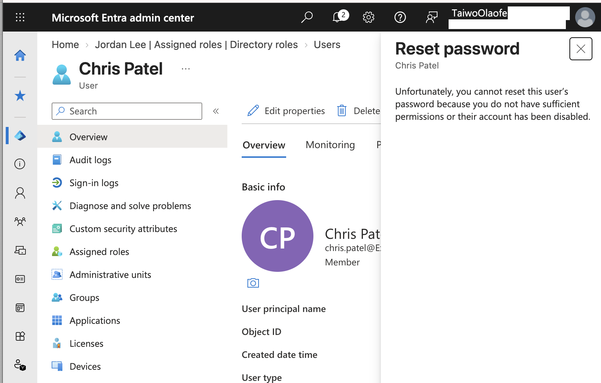

### Verifying the lockout
I opened a new private window and tried to sign in as Chris with the password he had been using. The sign-in failed with an error stating the account was locked. This confirmed the control actually worked, not just that the setting was changed.

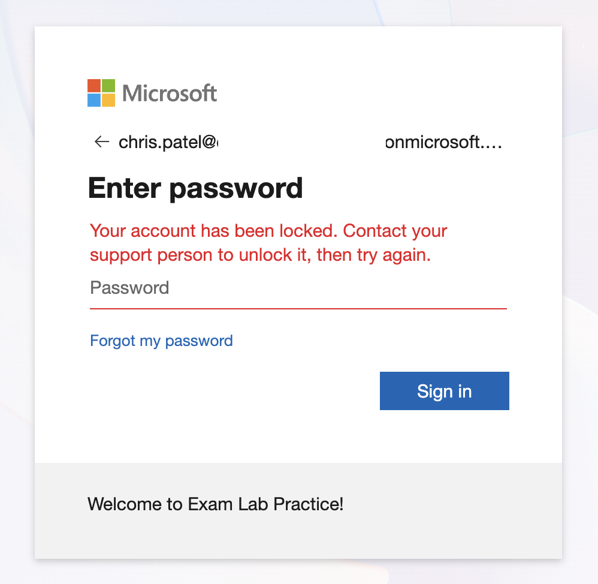

### Removing access
With the account locked out, I removed Chris from `SG-Dept-Finance` and `SG-AllStaff` and confirmed no admin roles were assigned. Removing access after the lockout ensures there's no window where the user can still act.

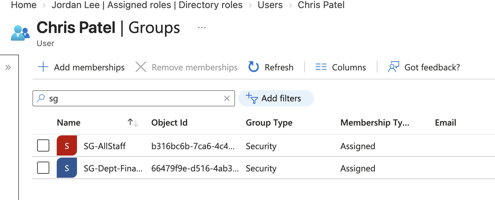

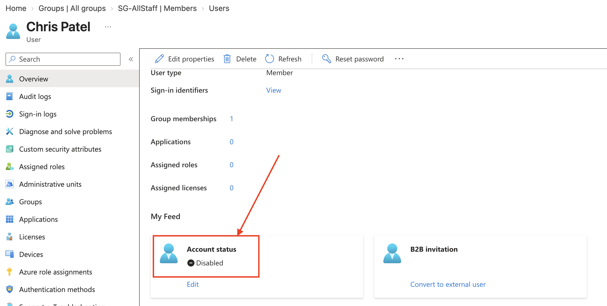

I then updated Chris's job title to *Former Employee - Finance Analyst* and department to *Terminated* to record the departure.

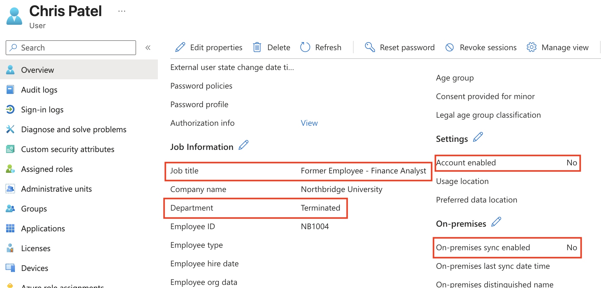

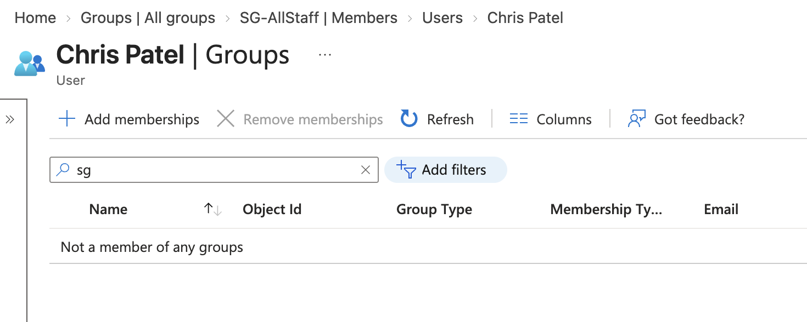

### Soft delete
In production, accounts are usually kept disabled for a retention period so the manager can recover files and email. For this lab I deleted the account to demonstrate Entra ID's **soft delete**: deleted users stay recoverable for 30 days before permanent deletion, which protects against offboarding the wrong person.

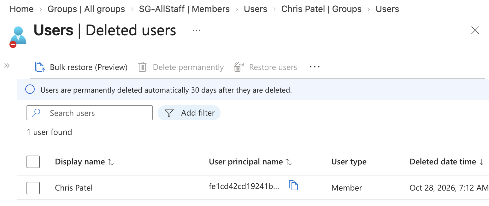

---

## 5. Audit and Evidence

Every change in this lab was recorded in Entra ID's logs. In real environments, this is how IT proves to auditors that a process was followed, and how incidents get investigated.

### Audit log
The audit log captured each lifecycle event: user creation, group membership changes, role assignments and removals, attribute updates, and the deletion.

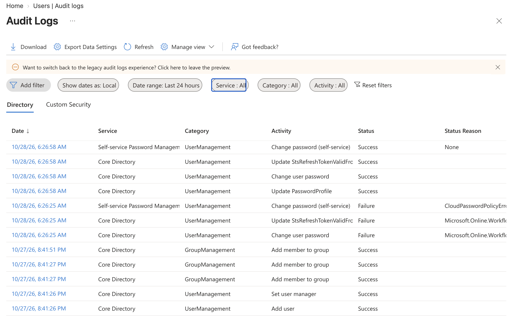

The detail view for Jordan's promotion shows the exact old and new values for both Job title and Department, which is direct evidence of the mover event.

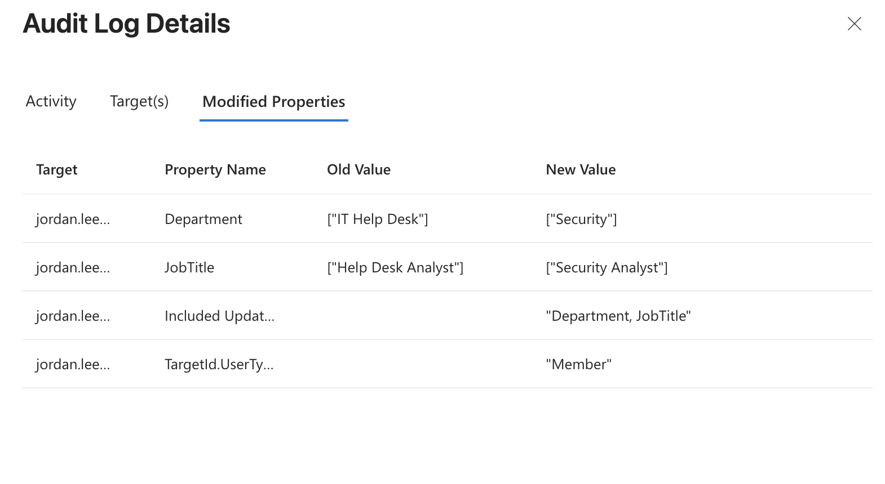

### Sign-in log
The sign-in log recorded Chris's failed sign-in attempt after offboarding, along with the failure reason.

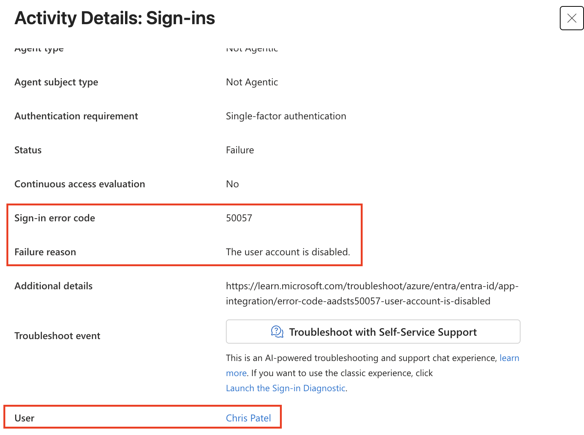

> Entra ID Free retains audit logs for only 7 days. In production, organizations stream logs to a SIEM such as Microsoft Sentinel for long-term retention.

---

## 6. Key Findings

**Order of offboarding steps matters in Entra ID.** I planned to block sign-in first and reset the password afterward, but Entra ID won't reset the password on a disabled account. The account was still fully locked out, but the finding changed how I'd write an offboarding runbook: **reset the password first, then immediately block sign-in, then revoke sessions**, all back to back.

**The mover stage is where access risk hides.** Adding access for a new role is the easy part. Removing the old group and the old admin role is what prevents privilege creep.

**Verification is part of the process.** Testing Maya's first sign-in and attempting to sign in as Chris after offboarding confirmed that each control actually worked.

---

## 7. How This Works in the Real World

I performed this lab manually to show each underlying step. In a real organization, most of this is automated:

| Manual step in this lab | How it's automated in production |
|---|---|
| Creating the user by hand | **HR-driven provisioning**: the HR system (e.g., Workday, SuccessFactors) is the source of truth and automatically creates the account in Entra ID. On-prem environments sync from Active Directory using **Entra Connect**. |
| Adding users to department groups | **Dynamic groups** (Entra ID P1): a rule like `user.department -eq "Finance"` adds and removes members automatically when the Department attribute changes. Jordan would have been moved between groups just by updating his department. |
| Mover access review | **Access reviews** (Entra ID Governance): managers periodically confirm whether their team still needs access. |
| Leaver checklist | **Lifecycle Workflows** (Entra ID Governance): pre-built joiner, mover, and leaver tasks that run automatically based on hire and leave dates. |
| Permanent admin roles | **Privileged Identity Management (PIM)** (Entra ID P2): admins get roles just-in-time, for a limited period and with approval, instead of permanently. |
| Leaver's mailbox and files | In Microsoft 365, the mailbox is often converted to a **shared mailbox** and OneDrive access is handed to the manager before the license is removed. |
| Keeping logs | Logs are streamed to a **SIEM** (e.g., Microsoft Sentinel) for long-term retention and alerting. |
